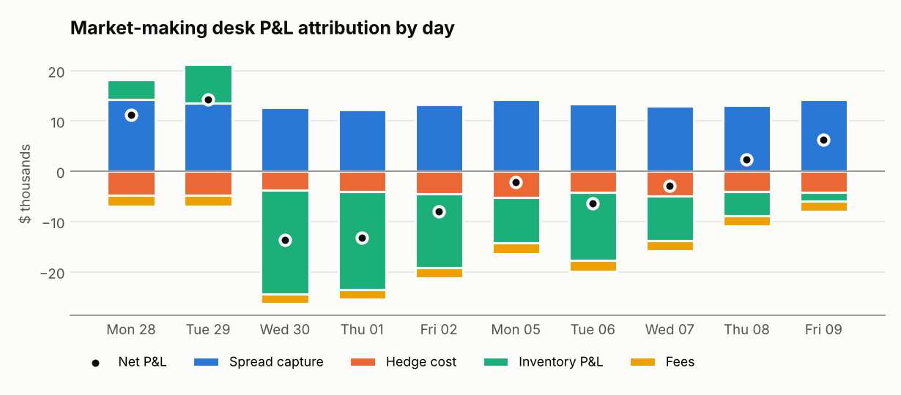
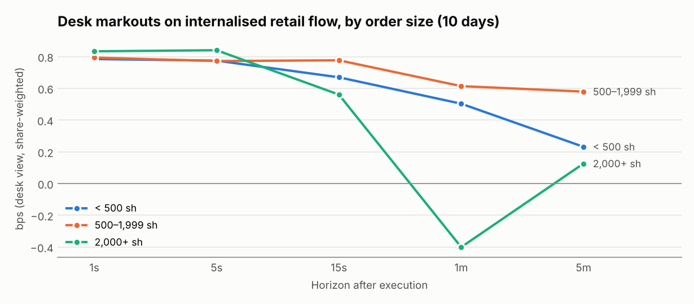
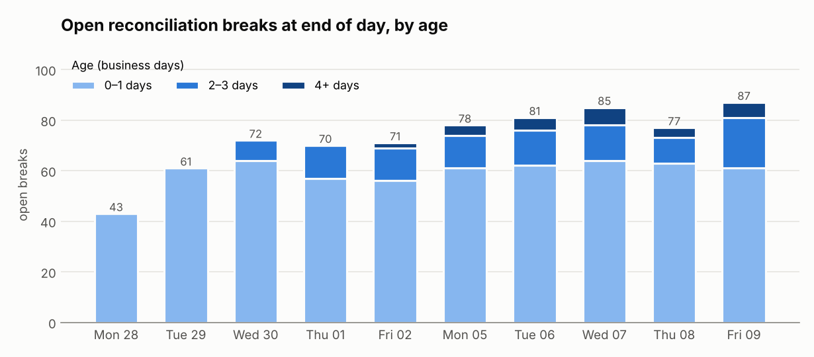
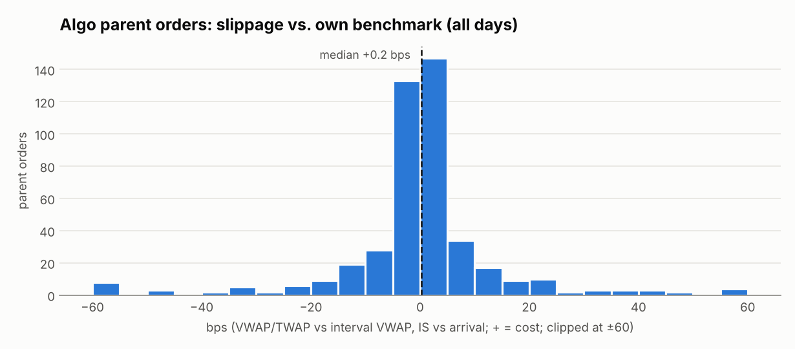

# Trading Operations Analytics in SQL & Python

[](https://github.com/solomonnjenga11-ai/execution-quality-ops/actions/workflows/ci.yml)
  

The checks a trading-operations analyst runs every day, built two ways:

1. **SQL trade analysis** — raw trade, price, FX and FIX files loaded into a database, then
   priced, reconciled and validated in plain SQL (CTEs, window functions, a recursive CTE).
2. **Daily ops pipeline** — a Python end-of-day run for an equities desk that internalises retail
   flow as principal and executes algo orders as agent, the two businesses an electronic market
   maker runs side by side.

👉 **[View the sample daily report](https://solomonnjenga11-ai.github.io/execution-quality-ops/)**

> **Data note:** all data is **synthetic**, generated from a seed by code in this repo. No real
> firm, client or market data is used. Known problems are injected on purpose (listed in
> [data/raw/README.md](data/raw/README.md)) and the tests prove each one is caught.

---

## Part 1 — SQL trade analysis

```bash
python -m eqops sql
```

Python loads the raw files (and parses FIX, validating CheckSum and BodyLength). **Every piece of
analysis is SQL**, in four numbered files:

| File | Problem it solves | SQL techniques |
|---|---|---|
| [`01_trade_pricing_asof.sql`](sql/analysis/01_trade_pricing_asof.sql) | Price each trade against the last market tick at or before it. Trades are stamped in ISO text, prices in epoch ms, and no timestamps line up | timestamp normalisation, as-of join via correlated subquery, `ROW_NUMBER()` duplicate detection, `CASE` status rules |
| [`02_position_pnl.sql`](sql/analysis/02_position_pnl.sql) | Position, average cost, realized and unrealized P&L per account and symbol, including long→short flips | **recursive CTE** carrying state trade by trade, window functions for close prices |
| [`03_data_quality.sql`](sql/analysis/03_data_quality.sql) | Validate FX currency pairs against a reference table; catch bad rates, dates and duplicates | `GLOB` pattern checks, reference-table joins, `UNION ALL` rule stacking into one issues queue |
| [`04_fix_order_lifecycle.sql`](sql/analysis/04_fix_order_lifecycle.sql) | Match FIX orders to execution reports; flag overfills, orphan fills, fills through the limit, resent ExecIDs, unacknowledged orders | dedup with window functions, running `SUM() OVER` vs reported CumQty, anti-joins |

The core of the as-of join:

```sql
SELECT t.*,
       (SELECT MAX(p.ts_ms)
          FROM raw_crypto_prices p
         WHERE p.symbol = t.symbol
           AND p.ts_ms <= t.trade_ts_ms) AS mark_ts_ms    -- last tick at or before the trade
FROM v_trades_norm t
```

**What it finds on the sample data**

| Check | Result |
|---|---|
| Crypto trades priced | 1,504: 1,470 clean, 20 on stale marks, and 4 duplicate bookings, 4 trades before the first tick, 3 with no price feed and 3 fat-finger prices flagged |
| FX bookings validated | 13 invalid currency pairs, 5 repairable formats, 4 bad rates, 3 value dates before trade date, 3 duplicates |
| FIX messages matched | 795 messages: 3 fills through the limit, 1 overfill, 1 orphan fill, 2 resent ExecIDs, 3 unacknowledged orders, 1 corrupted CheckSum |

**Every SQL result is cross-checked against an independent Python version** in
[`tests/test_sql_layer.py`](tests/test_sql_layer.py): the as-of join against `pandas.merge_asof`,
the recursive-CTE P&L against a plain-Python ledger, and the SQL currency rules against the Python
validator.

---

## Part 2 — Daily ops pipeline

```bash
python -m eqops --date 2026-10-09 --days 10 --seed 7 --out reports
```

Produces an HTML report, a SQLite database and CSVs covering:

* **Execution quality** — price improvement, effective vs quoted spread, Rule 605-style stats, markouts
* **Algo TCA** — arrival (implementation shortfall) and interval-VWAP slippage per parent order
* **Desk P&L attribution** — spread capture vs hedge cost vs inventory risk vs fees, reconciled to cash
* **Trade reconciliation** — internal blotter vs clearing statement, break classification and aging
* **Controls** — one ranked exceptions queue (trade-throughs, bad timestamps, limit breaches, stale breaks)

| Sample day: Fri 9 Oct 2026 | |
|---|---|
| Executions booked | 4,605 (≈ $1.9B notional) |
| Retail price improvement | $4,008, 68% of shares improved |
| Effective / quoted spread | 78.6% |
| Recon match rate | 99.2%, every injected break detected and correctly classified |
| Exceptions raised | 38 (4 critical trade-throughs) |



**What it shows:** spread capture is steady at roughly $12–14k a day, but inventory risk drives the
sign of daily P&L. That points the desk at hedging speed and position limits, not pricing.



**What it shows:** small retail orders stay profitable to the desk at every horizon. Orders of
2,000+ shares turn negative at one minute, the signature of informed flow.

<p float="left">
  
  
</p>

Analyst queries over the pipeline's database: [`sql/daily_ops_review.sql`](sql/daily_ops_review.sql)
(break aging, escalation list, running P&L, venue mix).

---

## Quick start

```bash
git clone https://github.com/solomonnjenga11-ai/execution-quality-ops.git
cd execution-quality-ops
python -m venv .venv && source .venv/bin/activate      # Windows: .venv\Scripts\activate
pip install -e ".[dev]"

python -m eqops sql                                    # Part 1
python -m eqops --out reports --images docs/images     # Part 2
pytest -q                                              # 30 tests
```

## Repository layout

```
data/raw/              raw inputs: crypto trades & prices, FX trades, FIX log (synthetic)
sql/analysis/          00 schema · 01 as-of pricing · 02 P&L · 03 data quality · 04 FIX lifecycle
sql/daily_ops_review.sql   queries over the Part 2 database
src/eqops/
  sql_runner.py        loads raw files, runs sql/analysis/, exports views
  fix_parser.py        FIX tag=value parser with CheckSum / BodyLength validation
  currency.py          currency-pair validator (ISO 4217)
  datasets.py          raw-file generator
  simulate.py tca.py pnl.py recon.py controls.py pipeline.py report.py   Part 2
practice/              12 SQL & Python practice problems with tested solutions
tests/                 30 tests
docs/                  methodology, charts, sample report (GitHub Pages)
```

## Design choices worth noting

* **SQL results are verified, not assumed.** Each query has an independent Python check.
* **Reconciliation does not double-count.** A re-keyed trade is one ID_MISMATCH, not a missing
  trade plus an unknown trade. Resent FIX ExecutionReports are counted once.
* **P&L is exact.** The recursive CTE handles position flips; the pipeline's P&L attribution sums
  to cash P&L to the cent.
* **Algos are judged against their own benchmark**: VWAP orders vs interval VWAP, IS vs arrival.
* **Thresholds are config, not code**, and every run is reproducible from a seed.

Formulas and assumptions: **[docs/methodology.md](docs/methodology.md)**.

## Limitations and next steps

* Swap the generators for real inputs: FIX drop copies, a vendor NBBO (e.g. TAQ), a clearing file.
* Port `sql/analysis/` to PostgreSQL (`LATERAL` joins for the as-of step) for larger volumes.
* Add cancels/amends, short-sale locates and CAT-style lifecycle checks.
* Schedule the run and push the exceptions queue to Slack or email.

## Author

**Solomon Mwangi** — MS Business Analytics (Suffolk University), BCom Finance (University of
Nairobi), nine-plus years of personal FX/equity/commodity trading. Open to trading operations,
middle office and execution analytics roles.

MIT licensed.
